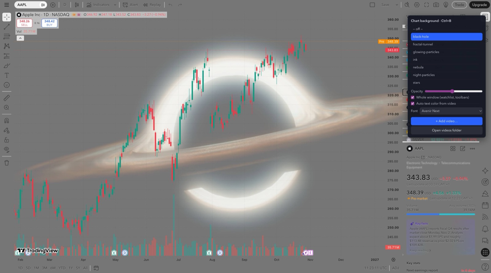

# larp-tradingview

> *Better-looking TradingView to blow up your evals in style. Your money still goes to the whales and market makers, but now there's an anime sunset behind it.* 🐋

**Live video wallpaper for TradingView Desktop.** Put a looping video (anime, lofi, space, city nights, Dubai larp, whatever) behind your charts, watchlist and toolbars. It's like BetterDiscord themes, but for TradingView.



- 🎬 Any looping `.mp4` / `.webm` / `.mov` as the chart background, or as the background for the whole window
- 🎛 In-app menu (**Ctrl+B**): switch videos, set opacity, add your own videos, pick a font
- 🎨 Auto text color: picks light or dark text tinted to match the current video, so labels stay readable
- 🧊 Frosted-glass dialogs and blurred panels
- 🔒 TradingView itself is never modified, and there is no Node or other dependency to install

macOS only (TradingView Desktop 3.x). Windows support is welcome as a PR.

## Install

Paste this into Terminal:

```bash
curl -fsSL https://raw.githubusercontent.com/pinatq/larp-tradingview/main/install.command | bash
```

Or download the repo and double-click `install.command` (right-click → Open the first time).

The installer:

1. creates **TradingView BG** in `~/Applications`. Open it instead of TradingView, or drag it to your Dock;
2. downloads 7 free starter loops from [Mixkit](https://mixkit.co) (about 45 MB) into `~/Library/Application Support/larp-tradingview/videos`.

Then press **Ctrl+B** in TradingView. Use **+ Add video…** to add more, or drop files into the folder from **Open videos folder**.

To remove it, run the installer again and choose **Uninstall**. Your videos stay where they are.

## How it works

TradingView Desktop is an Electron app. **TradingView BG** starts it with Chromium's remote debugging on a random port bound to `127.0.0.1`. A small injector, which runs on TradingView's own bundled runtime, then adds `bg.js` to the TradingView windows.

`bg.js` does four things:

- turns TradingView's background paint calls into transparent ones;
- makes the theme's panel colors transparent;
- puts a muted `<video>` underneath;
- serves the videos as `blob:` URLs, because TradingView's CSP blocks local files.

Why not patch the app? Since macOS 15, any change inside `TradingView.app` makes Gatekeeper report the app as "damaged", even after re-signing. So we don't touch it.

## ⚠️ Read this

- **Local debug port.** While TradingView runs through TradingView BG, other programs on *your own Mac* could connect to that port and control the logged-in TradingView session. It is not reachable from the network. Only use this on a machine you trust.
- **Unofficial.** This project is not affiliated with or endorsed by TradingView. Client mods like this are a gray area under most terms of service, so use it at your own risk.
- **Updates.** TradingView can change its CSS class names. If a panel turns opaque again after an update, open an issue.
- **Videos.** No videos ship in this repo. The starter loops are downloaded straight from Mixkit under the [Mixkit license](https://mixkit.co/license/). Only add videos you have the right to use.

## Keywords

tradingview plugin, tradingview theme, tradingview wallpaper, tradingview live wallpaper, tradingview animated background, tradingview video background, tradingview custom background, tradingview desktop mod, tradingview anime, tradingview aesthetic, betterdiscord for tradingview

## License

MIT
